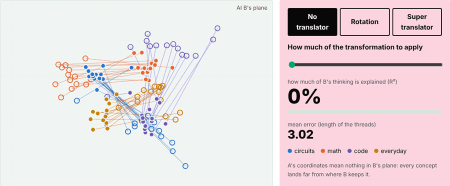
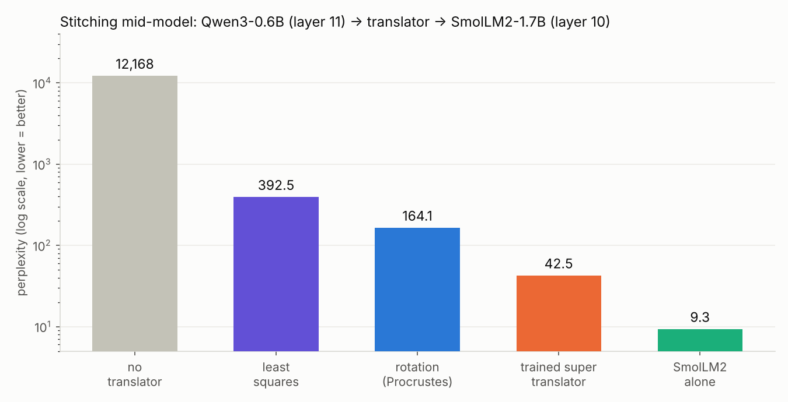
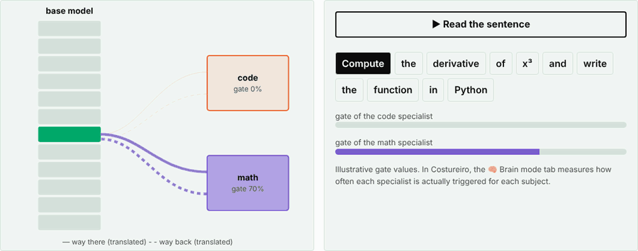

# 🧵 Costureiro — stitch the best parts of different LLMs into a new one

**English** · [Português](README.pt-BR.md)

> Take the first layers of a model that's good at **code**, join them to the last layers of a model that's good at **math**, and let a small learned **"super translator"** find the **change of basis** between their hidden spaces. It works across **model families, sizes and tokenizers**. The original models stay frozen; only the translator (a few MB) is trained. Everything runs on a single consumer GPU (6 GB).

<p align="center"></p>

<p align="center"><b>🖱️ <a href="https://thiagobueno5569.github.io/costureiro/#en">Interactive explainer</a></b> · <a href="#-results">Results</a> · <a href="#-how-it-works-the-math">Math</a> · <a href="#%EF%B8%8F-the-app">App</a> · <a href="#-brain-mode-specialists-on-demand">Brain mode</a></p>

## TL;DR

- 🔄 **Different LLMs think in almost the same geometry, just rotated.** From the middle of the network onward, a pure **rotation** (orthogonal Procrustes) explains **63%** of another family's hidden states, and **94%** within the same family.
- 🧵 **You can stitch them.** Qwen3-0.6B reads, a translator carries its thoughts into SmolLM2-1.7B, and SmolLM2 finishes the sentence. Perplexity drops from **12,168** with no translator to **164** with the rotation and **42.5** with the trained translator. SmolLM2 alone scores 9.3.
- 🧪 **First "new model":** Qwen2.5-Coder-0.5B (layers 0–9) + Qwen2.5-Math-1.5B (layers 11–27). On held-out math text it beats **both** originals (0.722 vs 0.864 bits/char), with an honest caveat below.
- 🧠 **Brain mode:** a base model calls **specialist blocks** from other models **token by token** through learned gates. It is a Mixture-of-Experts built out of different LLMs.

---

## 👀 The idea in one picture

Every model represents a concept ("capacitor", "derivative", `for i in range`) as a vector, but each model uses **its own coordinates**. Think of two people describing the same map, one in north/east and the other in "along the street / across the street". The places are the same; only the **basis** differs.

In the animation above, the frame is **model B's plane**. ○ marks where B keeps each concept, ● is the same concept coming from model A, and the **thread** between them is the error.

1. **No translator:** A's points land anywhere in B's plane, and the threads cross everything.
2. **Rotation (Procrustes):** A's plane is **rotated and uniformly scaled** until it fits. The topic clusters line up at once; some error remains where the space curves.
3. **Super translator:** starts from the rotation and learns to **bend the plane only where needed**. The threads almost vanish.

*The animation is a 2-D illustration with simulated points; the real models have 1024 and 2048 dimensions, and the measured numbers are below.*

---

## 📊 Results

<p align="center"></p>

**Cross-family stitching:** Qwen3-0.6B (Alibaba; 28 layers, d=1024) → translator → SmolLM2-1.7B (Hugging Face; 24 layers, d=2048). The table shows perplexity on 66 held-out chunks (lower is better). SmolLM2 alone scores **9.3**.

| stitch point | no translator | least squares | rotation (Procrustes) | **trained super translator** |
|---|---|---|---|---|
| 25% (layer 7 → 6) | 174,597 | 2,001 | 9,856 | — |
| **40% (11 → 10)** | 12,168 | 392 | 164 | **42.5** |
| 50% (14 → 12) | 3,863 | 279 | 177 | — |
| 60% (17 → 14) | 3,886 | 221 | 200 | 47.6 |
| 75% (21 → 18) | 7,025 | 213 | 236 | — |

1. **Hidden geometry is shared up to a rotation.** From the middle layers on, a pure rotation explains 63% of the other model ($R^2$). In the middle it even beats an unconstrained linear map (164 vs 392), despite having far fewer degrees of freedom.
2. **Early layers don't translate** ($R^2 \approx 0.01$). They are still tied to how each tokenizer splits words.
3. **The trained translator is 4× better than the rotation** (164 → 42.5). The stitched model writes *"A lei de Ohm diz que a corrente de um ponto é dada por: I(t) = V(t/Rt)…"*. The formula is still wrong, but the topic made it across.
4. **Massive activations carry information.** 99% of SmolLM2's variance sits in 8 dimensions, and normalizing them away makes stitching *worse* (164 → 305).
5. **Current limit: data.** With only 265 training chunks, the translator starts memorizing after epoch 3 (train 7–10 vs test 42).

**First new model: code + math.** The first layers of **Qwen2.5-Coder-0.5B** (0–9) go through a translator into the last layers of **Qwen2.5-Math-1.5B** (11–27). The cut point (40%) was picked automatically. Training used 3 MB of Python code and 7,473 GSM8K problems, 3 epochs, about 15 minutes. Numbers are bits per character on held-out text (lower is better):

| subject | Coder alone | Math alone | stitched (rotation) | **new model (trained)** |
|---|---|---|---|---|
| code | **0.730** | 1.360 | 1.391 | 1.283 |
| math | 0.866 | 0.864 | 1.031 | **0.722** |

6. **On math, the new model beats both originals by 16%.** Honest caveat: the translator was trained on GSM8K-style text and the originals were not, so part of the gain is format adaptation rather than better reasoning.
7. **On code, it lands in between.** The "speaking" half is the math model, which knows less code vocabulary.
8. **Within one family (Qwen2.5), the rotation alone explains 94%** ($R^2$).

Raw data: [`resultados/`](resultados/) · experiment scripts: [`experimentos/`](experimentos/).

---

## 🧠 Brain mode: specialists on demand

<p align="center"></p>

In plain stitching, every token flows through both models in sequence. In **brain mode**, a **base** model (the one that chats and interprets) runs in full. At one of its layers, a **gate** decides **for each token** whether to call a **specialist**: a block of layers from another model, such as the Coder's code layers or the Math model's math layers.

$$g_k = \sigma(\text{gate}_k(x)),\qquad x \leftarrow x + \sum_k g_k \cdot T^{\text{back}}_k\Big(\text{block}_k\big(T^{\text{in}}_k(x)\big)\Big)$$

- $T^{\text{in}}$ starts as the Procrustes rotation. $T^{\text{back}}$ starts at zero, so at step 0 the model *is* the base model.
- Training minimizes the base model's loss **plus a sparsity penalty** $\lambda\sum_k \bar g_k$, so a specialist is only called when it helps.
- Only the specialist's own layers are kept in GPU memory; the rest is pruned.
- In the chat view, every generated token is **colored by the specialist that was called** to write it.

*The gate values in the animation are illustrative; the app measures the real ones.*

---

## 📐 How it works (the math)

**1. Token grid.** The sequence follows the tokenizer of the **last** model, since that model picks the next token. For each grid token $j$, the first model contributes its last token $i$ that ends no later than $j$:

$$a(j) = \max\{\, i : \text{end}_A(i) \le \text{end}_B(j) \,\}$$

This alignment never leaks future text.

**2. Change of basis by geometry (orthogonal Procrustes).** Take the hidden-state pairs, already centered: $X$ is the previous part's output and $Y$ is what the next part would produce reading the same text on its own.

$$X_c^\top Y_c = U\Sigma V^\top \;\Rightarrow\; W = UV^\top,\qquad s = \frac{\operatorname{tr}\Sigma}{\|X_c\|_F^2}$$

**3. Super translator.** Start from the rotation and learn the rest end-to-end through the frozen downstream model:

$$g_\theta(x) = s\,W(x-\bar x) + \text{MLP}(x-\bar x) + \bar y,\qquad \min_\theta -\tfrac1N\sum_j \log p_B\big(t_{j+1}\,\big|\, f^B_{\ge c'}(g_\theta(h_A^{(c)}))\big)$$

**4. Best parts of each model.** A layer's importance for subject $a$ is how much the error rises when that layer is skipped:

$$\text{imp}(\ell, a) = \text{BPC}_a(\text{without } \ell) - \text{BPC}_a(\text{full model})$$

**5. Fair comparison.** Because the tokenizers differ, everything is compared in **bits per character**.

---

## 🖥️ The app

```bash
pip install -r requirements.txt
python preparar_textos.py   # sample focus texts: code (Python stdlib) + math (GSM8K)
python app.py               # opens http://127.0.0.1:7861
```

| Tab | What it does |
|---|---|
| **① Choose & analyze** | Measures what each model is good at (bits/char per subject) and draws a **map of its best layers** by skipping each layer and measuring the damage. It recommends which model should "speak". |
| **② Parts** | Pick the layer ranges of each model, with a live diagram of the new model. A button lets the super translator **find the best cut point**. |
| **③ Stitch** | Trains the translators on your focus texts, with a live progress bar, a live learning curve, and the new model vs. the originals for each subject. |
| **🧠 Brain mode** | A base model with specialists on demand, showing how often each specialist is called for each subject. |
| **④ Chat** | Generates text with the new model side by side with the originals. |
| **⑤ Export to LM Studio** | Turns the stitched model into a normal **`.gguf`** that opens in LM Studio, Ollama and llama.cpp, and copies it into LM Studio's models folder. |

Command line:

```bash
python cli.py --a Qwen/Qwen2.5-Coder-0.5B-Instruct --b Qwen/Qwen2.5-Math-1.5B-Instruct \
    --assunto code=textos/programacao --assunto math=textos/matematica --auto --nome code-plus-math
```

A new model is saved as a **recipe** (`receita.json`: which models and which layers) plus the **translators** (`tradutores.pt`). *The code and the UI are in Portuguese for now; the commands above are all you need.*

### 📦 Exporting to a normal model (`.gguf`)

A `.gguf` describes one stack of identical layers with one tokenizer, and the stitched model has a translator in the middle. So `exportar.py` has two routes, and picks one automatically:

- **Exact fusion** (minutes), when all parts share the family, size, tokenizer and RoPE (e.g. Qwen2.5-1.5B + Qwen2.5-Math-1.5B + Qwen2.5-Coder-1.5B). If part B expects `y = s·x·Q` with `Q` orthogonal, B's layers are rewritten to work directly in A's basis, because RMSNorm doesn't care about rotation or scale:

  | weights | becomes |
  |---|---|
  | input projections (q, k, v, gate, up) | `W · diag(g) · Qᵀ` (the norm gain `g` is absorbed, the norm becomes 1) |
  | output projections (o, down) | `Q · W / s` |
  | final head | `W · diag(g_final) · Qᵀ` |

  The result is a plain Qwen/Llama model: A's layers followed by B's layers. It is exact for the linear part of the translator (`teste_exportar.py` checks that a model written in a random rotated basis fuses back to the original). The small MLP and the mean shift don't fit in the weights, so the app measures the exported model again and shows what that cost.
- **Distillation** (any pair, slower): the stitched model is the teacher. For each training chunk we keep its 64 most likely next tokens. Then the last model (same tokenizer) learns to imitate it with LoRA, and the LoRA is merged into the weights.

Both routes end with the official llama.cpp converter (`convert_hf_to_gguf.py`, downloaded on first use) → `q8_0` by default.

---

## ⚖️ Limitations (honestly)

- All models sit on the GPU at once. With 6 GB, that is about 2–3B parameters in total.
- Generation has no KV cache, so it is slow on long outputs. This is a research tool.
- Each translator is specific to its pair of models and cut points.
- Export to `.gguf` loses the translator's non-linear part (fusion) or some quality (distillation). Brain-mode models can't be exported yet.
- With little data the translator memorizes. Use at least ~2 MB of text per subject.

## 🗺️ Roadmap

- [ ] 10–50× more training text, to see how close stitching gets to the full model
- [x] Code + math stitched model
- [x] Export to `.gguf` for LM Studio / Ollama / llama.cpp (exact fusion or distillation)
- [ ] Brain mode with real models: Qwen2.5-0.5B base + Coder and Math specialists
- [ ] Evaluate on math that is not GSM8K-style, to separate adaptation from reasoning
- [ ] **Shared latent space:** one encoder/decoder per model, so that any pair can talk without a pairwise translator
- [ ] Transplant MoE experts across models through the translator (see the sister project [fatiador](https://github.com/thiagobueno5569/fatiador))

## 📚 Related work

- Bansal, Nakkiran & Barak (2021), *Revisiting Model Stitching to Compare Neural Representations*
- Moschella et al. (2023), *Relative Representations Enable Zero-Shot Latent Space Communication*
- Huh et al. (2024), *The Platonic Representation Hypothesis*
- Ainsworth, Hayase & Srinivasa (2023), *Git Re-Basin: Merging Models modulo Permutation Symmetries*
- Sun et al. (2024), *Massive Activations in Large Language Models*
- Schönemann (1966), *A generalized solution of the orthogonal Procrustes problem*

## 👤 Author

**Thiago Bueno da Silva**, Electrical Engineering student at UFSJ, Brazil. Sister project: [**fatiador**](https://github.com/thiagobueno5569/fatiador), which runs giant MoE models on a consumer GPU by loading only the experts a conversation needs.

If this was useful or interesting, a ⭐ helps other people find it.
