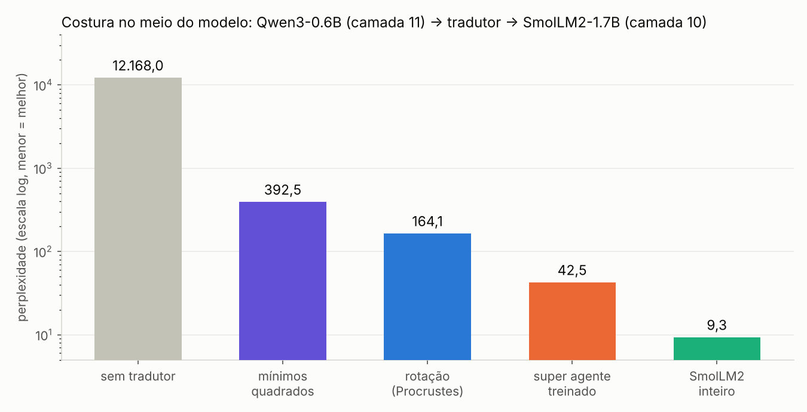

# 🧵 Costureiro

> **Crie uma IA nova juntando as melhores partes de outras IAs.** Pegue o começo de uma IA boa em programação, junte com o fim de uma IA boa em matemática, e deixe um *super agente tradutor* aprender a **mudança de base** entre os "pensamentos" das duas.

Funciona entre IAs de **empresas, tamanhos e tokenizers diferentes**. As IAs originais ficam congeladas; só o tradutor, de poucos MB, é treinado. Tudo roda num PC doméstico 

<p align="center"></p>

```
texto ─► [IA 1: camadas 0..c] ─► ⇄ tradutor ─► [IA 2: camadas c'..fim] ─► próxima palavra
          lê com o próprio        W·x + MLP(x)     escolhe as palavras com
          tokenizer               (aprende)        o próprio vocabulário
```

Também funciona com 3 IAs: a primeira lê, a do meio pensa e a última escreve.

---

## 🔬 O que descobrimos

**Experimento:** o Qwen3-0.6B (Alibaba; 28 camadas, vetor de 1024) lê o texto. Um tradutor leva o pensamento dele para dentro do SmolLM2-1.7B (Hugging Face; 24 camadas, vetor de 2048), que termina a frase. A tabela mostra a perplexidade em 66 trechos que o tradutor nunca viu. O SmolLM inteiro faz **9,3**.

| ponto da costura | sem tradutor | mínimos quadrados | rotação (Procrustes) | **super agente treinado** |
|---|---|---|---|---|
| 25% (camada 7 → 6) | 174.597 | 2.001 | 9.856 | — |
| **40% (11 → 10)** | 12.168 | 392 | 164 | **42,5** |
| 50% (14 → 12) | 3.863 | 279 | 177 | — |
| 60% (17 → 14) | 3.886 | 221 | 200 | 47,6 |
| 75% (21 → 18) | 7.025 | 213 | 236 | — |

1. **A geometria interna de IAs diferentes é quase a mesma, só girada.** Do meio para o fim do modelo, uma **rotação pura** explica 63% do pensamento da outra IA ($R^2$). No meio, ela ainda ganha da matriz livre (164 contra 392), mesmo com muito menos liberdade.
2. **O começo não se traduz** ($R^2 \approx 0{,}01$). Ali cada IA ainda está presa ao jeito como o próprio tokenizer corta as palavras.
3. **O super agente treinado é 4× melhor que a rotação** (164 → 42,5). O modelo costurado escreve: *"A lei de Ohm diz que a corrente de um ponto é dada por: I(t) = V(t/Rt)…"*. A fórmula ainda está errada, mas o assunto atravessou de uma IA para a outra.
4. **As "dimensões gigantes" carregam informação.** 99% da variância do SmolLM está em 8 dimensões. Normalizá-las antes de traduzir **piora** a costura (164 → 305).
5. **Limite atual:** com só 265 trechos de texto, o tradutor começa a decorar a partir da 3ª época (treino 7–10 contra teste 42). O próximo passo é usar mais texto.

### 🧪 Primeira IA nova: programação + matemática

Começo do **Qwen2.5-Coder-0.5B** (camadas 0–9) → tradutor → fim do **Qwen2.5-Math-1.5B** (camadas 11–27). O super agente escolheu sozinho o corte em 40%. Foram usados 3 MB de código Python e 7.473 problemas do GSM8K, com 3 épocas e 15 minutos de treino. Os números são bits por caractere em textos de teste (menor = melhor):

| assunto | só o Coder | só o Math | costurada (rotação) | **IA nova (treinada)** |
|---|---|---|---|---|
| programação | **0,730** | 1,360 | 1,391 | 1,283 |
| matemática | 0,866 | 0,864 | 1,031 | **0,722** |

6. **Em matemática, a IA nova ficou 16% melhor que as duas originais** (0,722 contra 0,864). Uma ressalva honesta: o tradutor foi treinado em problemas do mesmo estilo do teste (GSM8K) e as originais não. Parte do ganho é adaptação ao formato, não necessariamente raciocínio melhor.
7. **Em programação, ela ficou entre as duas:** melhor que o Math sozinho, mas longe do Coder (1,283 contra 0,730). A IA que escreve a resposta é a de matemática, e ela não conhece tão bem o vocabulário de código.
8. **Entre IAs da mesma família (Qwen2.5), a rotação sozinha já explica 94%** ($R^2$), contra 63% entre famílias diferentes.
9. O texto gerado já mistura as duas coisas: começa com `def area_circulo(r): return 3.14 * r * r` e segue com exemplos numéricos de cálculo de área.

Dados brutos em [`resultados/`](resultados/). Scripts dos experimentos em [`experimentos/`](experimentos/).

---

## 🖥️ O programa

```
python preparar_textos.py   # textos de exemplo: programação (código Python) e matemática (GSM8K)
python app.py               # abre em http://127.0.0.1:7861   (no Windows: ABRIR_COSTUREIRO.bat)
```

| Passo | O que faz |
|---|---|
| **① Escolher e analisar** | Mede no que cada IA é boa, em bits por caractere por assunto. Mostra um **mapa das melhores partes**: desliga cada camada e mede quanto a IA piora sem ela, em cada assunto. No fim, recomenda qual IA deve escrever a resposta. |
| **② Partes** | Escolhe as camadas de cada IA, com um desenho da IA nova que se atualiza ao mexer. O botão *achar o melhor ponto de corte* testa vários pontos só com a rotação e marca o melhor num gráfico. |
| **③ Costurar** | Treina os tradutores no texto do foco, com andamento ao vivo, curva de aprendizado e comparação da IA nova contra as originais em cada assunto. |
| **④ Conversar** | Gera texto com a IA nova, lado a lado com as originais. |

Também dá para usar pela linha de comando:

```
python cli.py --a Qwen/Qwen2.5-Coder-0.5B-Instruct --b Qwen/Qwen2.5-Math-1.5B-Instruct \
    --assunto programação=textos/programacao --assunto matemática=textos/matematica --auto --nome codigo-mais-mat
```

A IA nova é salva como uma **receita** (`receita.json`, que guarda quais IAs e quais camadas) mais os **tradutores** (`tradutores.pt`).

---

## 📐 A matemática

**1. Grade de tokens.** A sequência segue o tokenizer da **última** IA, que é a que escolhe a próxima palavra. Para cada token $j$ dessa grade, a primeira IA contribui com o último token $i$ que termina antes dele:

$$a(j) = \max\{\, i : \text{fim}_A(i) \le \text{fim}_B(j) \,\}$$

Assim nada do futuro vaza.

**2. Mudança de base por geometria (Procrustes).** Com os pares de vetores $X$ (saída da parte anterior) e $Y$ (o que a parte seguinte produziria lendo o mesmo texto sozinha), já centralizados:

$$X_c^\top Y_c = U\Sigma V^\top \quad\Rightarrow\quad W = UV^\top,\qquad s = \frac{\operatorname{tr}\Sigma}{\|X_c\|_F^2}$$

$W^\top W = I$: é uma rotação que preserva ângulos e distâncias.

**3. Super agente.** O tradutor começa na rotação e aprende por gradiente:

$$g_\theta(x) = s\,W(x-\bar x) + \text{MLP}(x-\bar x) + \bar y,\qquad \min_\theta\; -\tfrac1N\sum_j \log p_B\big(t_{j+1}\,\big|\, f^B_{\ge c'}(g_\theta(h_A^{(c)}))\big)$$

O gradiente atravessa as camadas congeladas da IA B e só muda $g_\theta$. O treino guarda a melhor época no texto de teste.

**4. Melhores partes.** A importância da camada $\ell$ para o assunto $a$ é quanto o erro sobe quando ela é desligada (a saída vira a própria entrada):

$$\text{imp}(\ell, a) = \text{BPC}_a(\text{sem } \ell) - \text{BPC}_a(\text{modelo inteiro})$$

**5. Medida justa.** Como os tokenizers são diferentes, tudo é comparado em **bits por caractere**.

---

## ⚖️ Limites (com honestidade)

- Todas as IAs ficam na placa ao mesmo tempo. Com 6 GB, cabem uns 2 a 3 bilhões de parâmetros somando todas.
- A geração não usa cache de atenção: é lenta em textos longos. Serve para experimentar, não para uso diário.
- Cada tradutor vale **só** para aquele par de IAs e aqueles pontos de corte.
- A IA nova roda neste programa, em Python. Ela não vira um arquivo GGUF.
- Com pouco texto, o tradutor decora em vez de aprender. Use pelo menos uns 2 MB de texto por assunto.

## 🗺️ Próximos passos

- [ ] Treinar com 10 a 50× mais texto e medir quanto a costura chega perto da IA inteira
- [x] Resultado da costura **Coder + Math** (programação + matemática)
- [ ] Medir em problemas de outro estilo (não GSM8K), para separar adaptação de raciocínio
- [ ] **Espaço comum:** um codificador e um decodificador por IA, para que qualquer par converse sem treinar um tradutor por par
- [ ] Transplantar especialistas de um MoE para outro através do tradutor (ligação com o [fatiador](https://github.com/thiagobueno5569/fatiador))

## 📚 Trabalhos relacionados

- Bansal, Nakkiran & Barak (2021), *Revisiting Model Stitching to Compare Neural Representations*
- Moschella et al. (2023), *Relative Representations Enable Zero-Shot Latent Space Communication*
- Huh et al. (2024), *The Platonic Representation Hypothesis*
- Ainsworth, Hayase & Srinivasa (2023), *Git Re-Basin: Merging Models modulo Permutation Symmetries*
- Sun et al. (2024), *Massive Activations in Large Language Models*
- Schönemann (1966), *A generalized solution of the orthogonal Procrustes problem*

## 👤 Autor

**Thiago Bueno da Silva**, estudante de Engenharia Elétrica na UFSJ. Projeto irmão: [fatiador](https://github.com/thiagobueno5569/fatiador), que roda IAs gigantes numa placa comum carregando só os especialistas do assunto.
